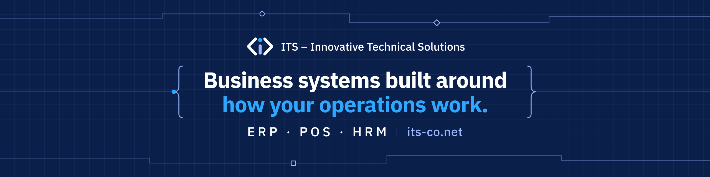

  

# Hi, I'm Walid Kelzia

**Founder of [ITS – Innovative Technical Solutions](https://its-co.net)** · Product Owner · Business Analyst 
I build management systems that run real businesses: inventory, sales, finance and HR.

[ITS](https://its-co.net) · [Website](https://walidkelzia.com/) · [LinkedIn](https://www.linkedin.com/in/walid-kelzia/) · [@its-co on GitHub](https://github.com/its-co)

---

## ITS – Innovative Technical Solutions

A software development company building **business management systems** for local companies, public-sector organizations and international clients.

| What we build | Examples |
|---|---|
| ERP & Operations | Inventory, purchasing, multi-branch operations |
| POS & Retail | Sales, invoicing, multi-currency and cash workflows |
| Financial Systems | Financial cycles, accounts, reporting |
| HRM | Employees, attendance, payroll, administrative workflows |
| Web Platforms | Corporate websites, Arabic-first (RTL) and bilingual |

## Products & Projects

| Project | Description |
|---|---|
| **GoldTag** | Gold shop management system: inventory by weight and karat, sales, financial cycle |
| **GoldTag Website** | Product website for GoldTag, with a built-in gold cut calculator |
| **ITS Website** | Bilingual (Arabic / English) company website |

## How We Work

Product thinking comes first, code comes second.

1. **Discovery** — understand the business, its rules and its constraints
2. **Scope** — define the MVP, protect it, and plan later phases
3. **Design** — UI built with Claude Design, Arabic-first and RTL-ready
4. **Build** — development with Claude Code, delivered in testable phases
5. **Handoff** — clear business rules, edge cases and acceptance criteria

## Background

Computer Engineer and Agile Product Owner with experience in **FinTech**, **ERP / POS** and **B2B systems**.

`Agile / Scrum` `Business Analysis` `Product Discovery` `Notion` `Figma` `Mermaid` `Claude Code` `Claude Design`

Arabic (Native) · Turkish (Fluent) · English (Intermediate)

---

**Have a system to build?** Reach out via [its-co.net](https://its-co.net).
